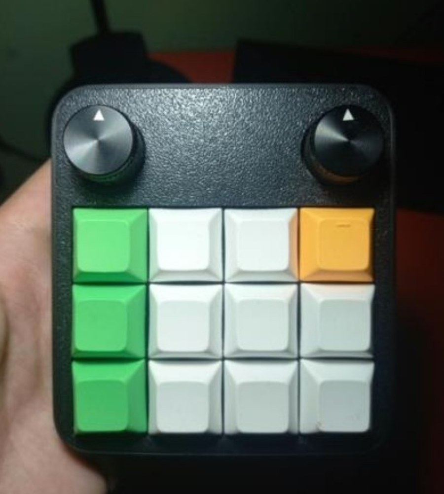
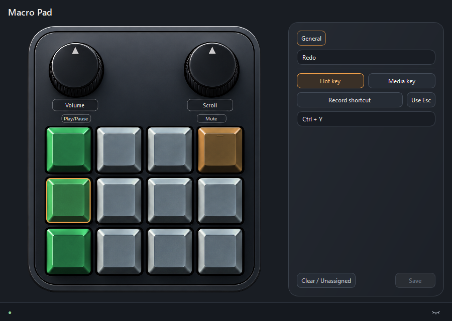
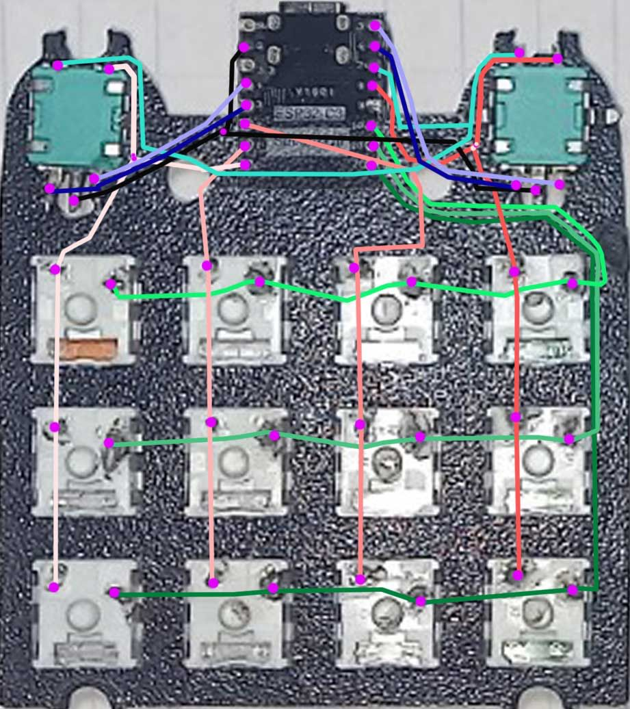

# Macro Pad

A handmade **ESP32-C3 macro pad** (12 keys, 2 knobs that also click) with a desktop app
for **Windows and macOS**. It turns each key and knob into a keyboard shortcut, media key or
scroll, with a separate profile for each app you use.

<p align="center">
  
  &nbsp;
  
</p>

```
Macro Pad  ──USB serial──▶  desktop app  ──▶  shortcuts · media keys · scrolling
(ESP32-C3)   "KEY:5"        (profiles)         in whatever app is in front
```

**Status:** V1, stable. The Windows app and installer are tested. The macOS app has been
used daily, but the newest features (tray mode, start at login, `.dmg`) haven't been tested
on a Mac yet. The firmware source will be added soon; the protocol and wiring below are
complete.

## Contents

- [Features](#features)
- [Install](#install)
- [Using the app](#using-the-app)
- [Hardware](#hardware)
- [Firmware](#firmware)
- [Message format (pad ↔ app)](#message-format-pad--app)
- [Build from source](#build-from-source)
- [Project layout](#project-layout)
- [Roadmap](#roadmap)
- [The story](#the-story)
- [License](#license)

## Features

- **Set it up by clicking:** click a key or knob on the drawing of the pad, then pick what it does.
- **Any keyboard shortcut:** record it by pressing it; you can also use media keys
  (volume, mute, play/pause) and mouse-wheel scrolling on the knobs.
- **Labels:** give every key and knob your own name.
- **Live feedback:** each press lights up on screen.
- **Profiles:** add, rename, delete, import, export and lock.
- **Automatic profiles:** the pad switches to the profile of the app in front (e.g.
  Browser for Chrome or Brave, Krita for Krita). Any app can be assigned to any profile.
- **Runs in the background:** a tray / menu-bar icon, an optional start at login, and
  only one copy runs at a time.
- **Ready to use:** a new install starts with useful General and Browser mappings.
- **Made for creative apps** like Photoshop, After Effects, Premiere Pro, Illustrator,
  Blender and Krita.

## Install

Download from the [**Releases**](../../releases) page.

### Windows 10 / 11

1. Run `MacroPad-Setup-<version>.exe`. The app isn't code-signed, so Windows SmartScreen
   may say "Windows protected your PC": click **More info → Run anyway**.
2. Choose your options: **desktop shortcut** and **start when I sign in**.
3. Plug in the pad. The tray icon (near the clock) shows **Connected**.

Uninstall from **Settings → Apps**. Your settings are kept in `%APPDATA%\Macro Pad\`.

### macOS (Apple Silicon)

1. Open `MacroPad-<version>-macOS.dmg` and drag **Macro Pad** onto **Applications**.
2. Open it. The app isn't notarized, so macOS blocks it the first time: go to
   **System Settings → Privacy & Security**, scroll down and click **Open Anyway**.
3. Allow **Accessibility** (System Settings → Privacy & Security → Accessibility) so
   it can send shortcuts.

Settings live in `~/Library/Application Support/Macro Pad/`.

## Using the app

| To… | Do this |
|---|---|
| Open the window | Double-click the tray icon (Windows), or tray / menu-bar icon → **Open** |
| Assign a key | Click it on the drawing → **Hot key** → **Record shortcut** → press the keys → **Save** |
| Use a media key | Choose **Media key** → Volume up/down, Mute, Play/Pause, Scroll up/down |
| Name a control | Type a label above the action; it shows on the drawing |
| Switch profile | Click the profile button (top right) and pick one; it lasts until you switch apps |
| Tie an app to a profile | Profile menu → **Assign Application…** → pick the `.exe` / `.app` |
| Keep one profile | Profile menu → **Lock profile** |
| Back up / share | Profile menu → **Export…** / **Import…** |
| Start at login | Tray menu → **Start at login** (ticked = on) |
| Quit | Tray menu → **Quit**. Closing the window only hides it. |

How the profile is chosen: a locked profile wins; then a profile you picked by hand (until the
app in front changes); then the profile assigned to that app; then built-in app names
(e.g. `chrome.exe` / Google Chrome → **Browser**); and otherwise the default (**General**).

## Hardware

| Part | Notes |
|---|---|
| Microcontroller | **ESP32-C3** board with native USB (4 MB flash), e.g. ESP32-C3 SuperMini |
| Keys | 12 mechanical key switches + keycaps |
| Knobs | 2 rotary encoders with push button |
| Connection | USB-C to the computer (power + data) |

### Wiring map (current)

The keys are wired as a **4 × 4 matrix**: three rows of keys and a fourth row for the two
knob clicks. That's 8 pins for 14 buttons. The knob turns use their own pins.

|  | **C1 · GPIO8** | **C2 · GPIO2** | **C3 · GPIO1** | **C4 · GPIO0** |
|---|---|---|---|---|
| **R1 · GPIO10** | K1 | K2 | K3 | K4 |
| **R2 · GPIO20** | K5 | K6 | K7 | K8 |
| **R3 · GPIO21** | K9 | K10 | K11 | K12 |
| **R4 · GPIO7** | Left knob click | — | — | Right knob click |

| Knob | Turn (A / B) | Common | Click |
|---|---|---|---|
| Left (ENC1) | GPIO5 / GPIO6 | GND | R4 × C1 (GPIO7 + GPIO8) |
| Right (ENC2) | GPIO3 / GPIO4 | GND | R4 × C4 (GPIO7 + GPIO0) |

Keys are numbered K1–K12 left to right, top to bottom, with the knobs at the top and the
USB port at the back.

<p align="center">
  
</p>

The original wiring (one pin per key, with some pins shared) caused ghost presses. It's kept
for reference only in [`docs/hardware/historical/`](docs/hardware/historical/), so **don't
use it**.

## Firmware

- **Tools:** VS Code + PlatformIO, Arduino framework, board `esp32-c3-devkitm-1`.
- **USB:** native USB CDC serial at **115200** baud. The pad is **not** a USB keyboard
  (HID); the desktop app turns its messages into actions.
- **Behaviour:** scans the matrix, debounces every key, reads both encoders on their detents,
  and sends one line per event (see below).
- **Verified:** all 18 inputs, 20-press stress tests, simultaneous key + knob presses.
- **Source:** coming soon in [`firmware/`](firmware/). In the meantime, any firmware that
  follows the message format below works with the app.

Flash with PlatformIO: open `firmware/` in VS Code → PlatformIO → **Upload**.

## Message format (pad ↔ app)

Plain ASCII text lines over USB serial, **115200 baud**, each ending in `\n` (`\r\n` is
accepted too).

**1. Handshake.** The app finds the pad by asking every serial port:

| Direction | Message | Notes |
|---|---|---|
| App → pad | `WHO` | Repeated every 0.4 s until answered, for up to 3.5 s per port |
| Pad → app | `MACROPAD:V1` | Only a port that answers this is used |

**2. Events.** The pad sends one line per input:

| Message | Meaning |
|---|---|
| `KEY:1` … `KEY:12` | Key pressed (K1–K12) |
| `ENC1:CW` / `ENC1:CCW` | Left knob turned one step clockwise / counter-clockwise |
| `ENC2:CW` / `ENC2:CCW` | Right knob turned one step |
| `ENC1:PRESS` / `ENC2:PRESS` | Knob clicked |

Rules:
- A line is one event, sent when the key goes **down** (there's no release message).
- Unknown lines are ignored, and so are lines longer than 64 bytes. Debug output can't
  trigger actions.
- Physical pin numbers never appear in messages; the app only knows logical names.
- If the pad is unplugged, the app keeps looking and reconnects by itself.

Try it without the app: `python desktop/monitor_events.py` finds the pad and prints every
event.

## Build from source

Needs **Python 3.12+**. Full details, including tests and both installers, are in
[`desktop/README.md`](desktop/README.md).

```powershell
# Windows
cd desktop
py -3.13 -m venv .venv-win
.\.venv-win\Scripts\python.exe -m pip install -r requirements-build.txt
.\.venv-win\Scripts\python.exe app.py          # run
.\build_installer.ps1                           # build the setup .exe (needs Inno Setup 6)
```

```sh
# macOS
cd desktop
python3 -m venv .venv
.venv/bin/python -m pip install -r requirements-build.txt
.venv/bin/python app.py                         # run (as "Macro Pad DEV")
./build_macos.sh                                # build the .app and .dmg
```

Tests: `cd desktop/tests` then `python -m unittest discover -s .` with
`QT_QPA_PLATFORM=offscreen` set.

## Project layout

| Path | What it is |
|---|---|
| [`desktop/`](desktop/) | The desktop app (Python, PySide6): one code base for Windows and macOS, with tests and installers |
| [`firmware/`](firmware/) | ESP32-C3 firmware (source coming soon) |
| [`docs/hardware/`](docs/hardware/) | Wiring pictures |
| [`docs/design/`](docs/design/) | The original UI design mockup |
| [`docs/presentation/`](docs/presentation/) | Plan for the demo video |
| [`STATE.md`](STATE.md) | Development status and decisions, for contributors |

## Roadmap

- [x] **V1:** 12 keys, 2 knobs with clicks, profiles, automatic profiles, Windows + macOS
- [x] Tray / menu-bar mode, start at login, Windows installer, macOS disk image
- [ ] Firmware source in this repo
- [ ] Test the macOS build of the new features
- [ ] **V1.5:** Fn layer, knob modifiers (Fn + knob), tap vs hold
- [ ] **V2:** Bluetooth and a battery for wireless use
- [ ] **V2:** advanced key combos and a redesigned case

## The story

I bought this pad from a maker on 30 September 2026. On day one it didn't work: Windows
saw no input, and on macOS it was too slow to use. Inside, a wire had come loose and some
keys shared pins, causing ghost presses. So I mapped every connection, rewired the keys into
a matrix, wrote new firmware that sends simple text messages, and built this desktop app,
first for Windows and then for macOS. Two weeks later it was a reliable tool I use every
day. This repo is everything I learned, so it can help someone else build or fix their own.

Thanks to the maker who built the original pad. None of this would have started without it.

## License

[GPL-3.0](LICENSE). You're free to use, study, change and share this project; if you share a
modified version, it must stay open source under the same license.

Built with [PySide6 / Qt](https://www.qt.io/qt-for-python),
[pyserial](https://github.com/pyserial/pyserial) and
[pynput](https://github.com/moses-palmer/pynput).
