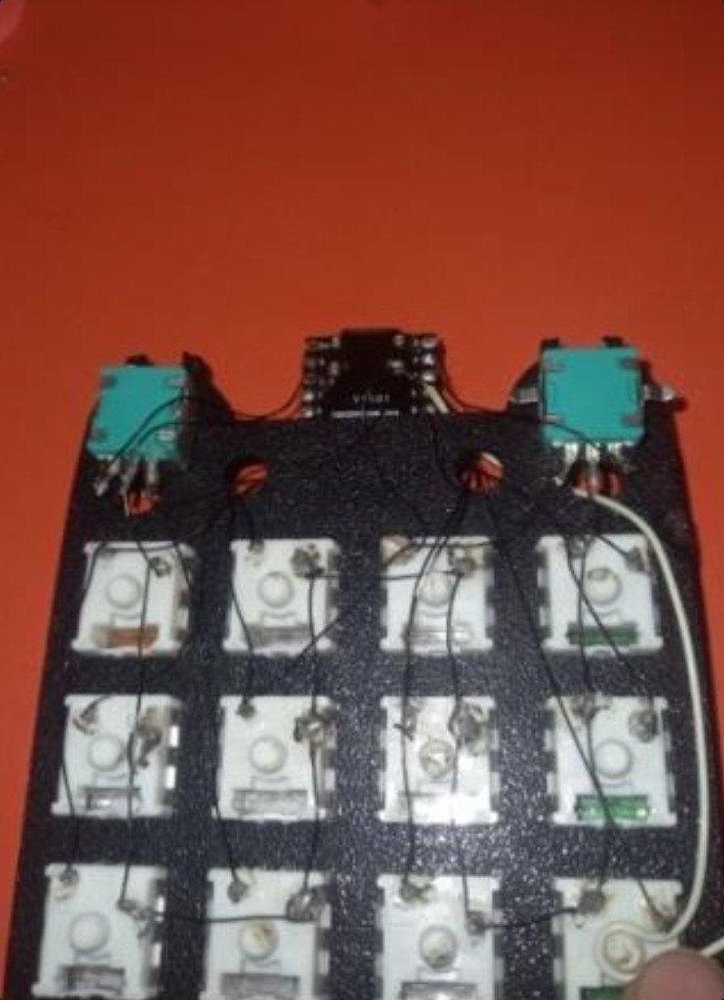
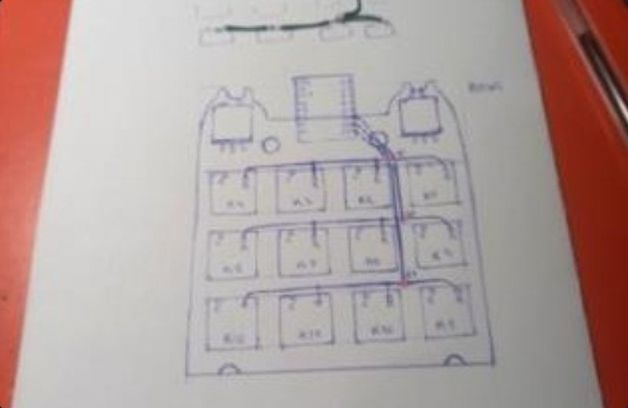
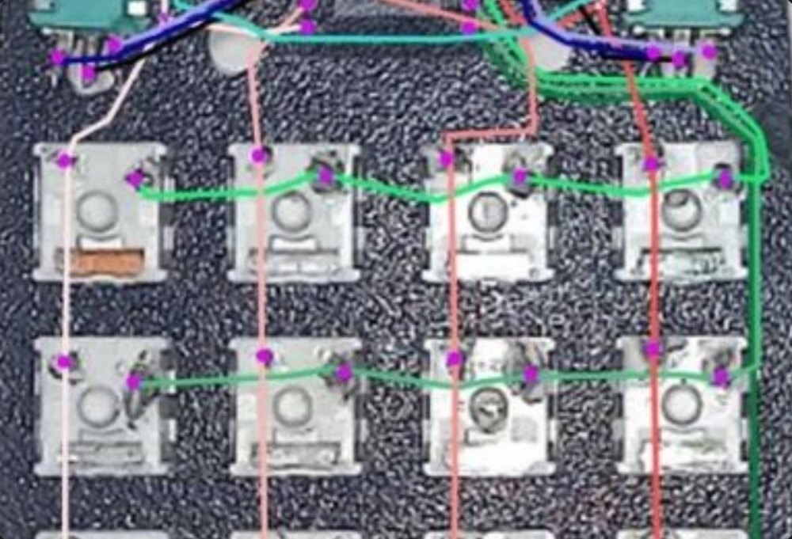
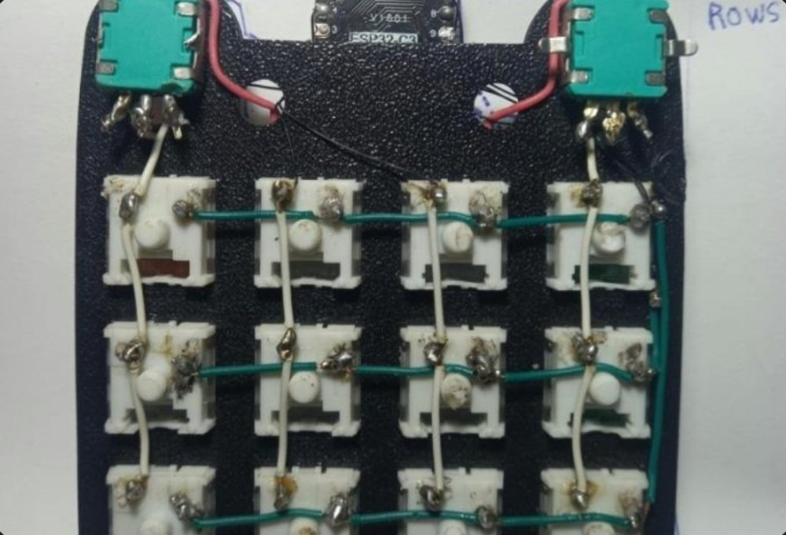
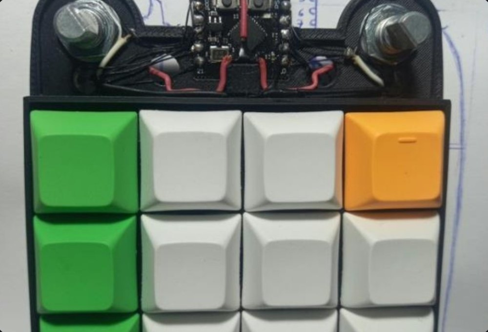
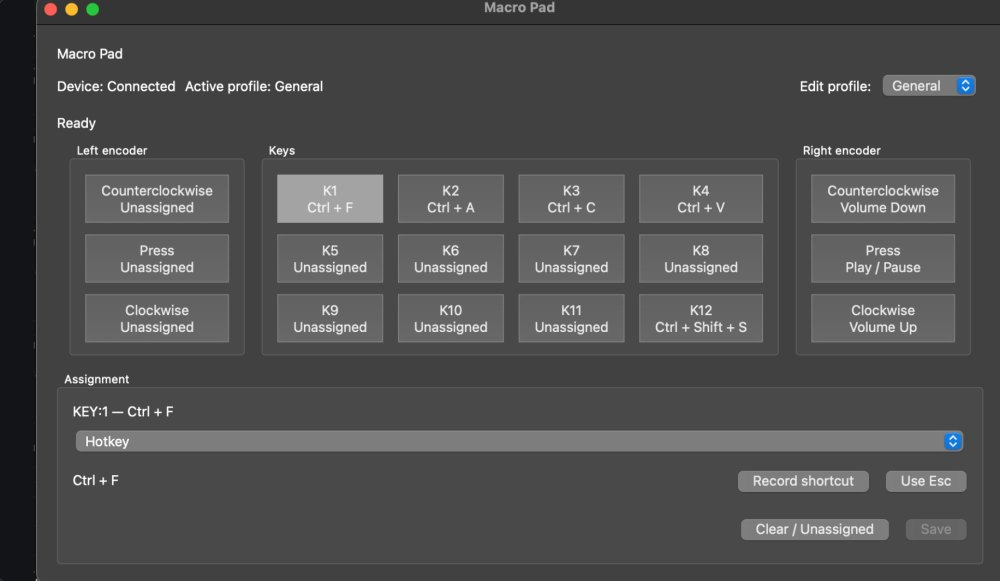
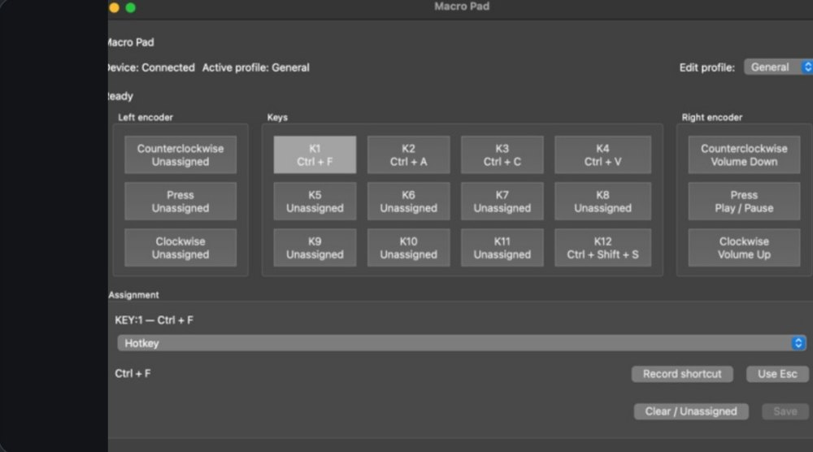
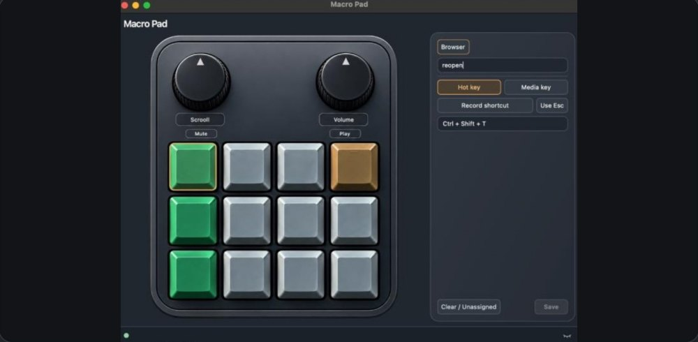

# Project journey

How a store-bought macro pad that didn't work became a reliable, open-source tool in
two weeks (30 September – 14 October 2026).

## 30 September — first test

I'd planned to build my own macro pad from parts, but found one a maker had already built
and bought it instead. The day it arrived I plugged it in, and:

- **Windows:** no input at all.
- **macOS:** it responded, but too slowly to use.

## 2 October — opening it up

Part of the answer was inside the case. I traced every connection: one key wire had come
loose, a few joints were fragile, and the knob clicks weren't wired in at all.

  
  

**Best guess at the cause:** some keys shared microcontroller pins, causing ghost presses and
junk messages. That made the app lag on the Mac and fail on Windows. So rather than patch
things one at a time, I mapped everything and planned a clean rewire.

## 3–4 October — the hardware rebuild

I rewired the keys from one pin per key (some shared) into a **4 × 4 matrix**: three rows
of keys plus a fourth row for both knob clicks. Now 8 pins read 14 buttons, and the knob
turns keep their own pins. The full pin map is in the [README](../README.md#wiring-map-current).

| Mapping the connections | Rebuilt wiring | Updated layout |
|---|---|---|
|  |  |  |

## 5–6 October — firmware and testing

New firmware sends each input as a short text message, such as `KEY:5` or `ENC1:CW`
([message format](../README.md#message-format-pad--app)). I tested every key, turn and
click, ran 20-press stress tests, checked simultaneous presses and debouncing, then **froze
the firmware** once all 18 inputs were reliable.

## 3–7 October — the desktop app (Windows)

The app is the bridge between the pad and the computer: it receives messages over USB and
turns each one into an action, per profile. Windows was the first version packaged and
working.

## 6–11 October — macOS

Bringing it to macOS meant solving the device connection, shortcuts and media keys, detecting
the app in front, automatic profiles, and packaging it as a normal Mac app. On 11 October
the installed app was in everyday use.

## 11–14 October — designing the app

The most fun part, and the most effort. The rule: reliability first, then simplicity,
function and customization, with looks last. The settings tool became a drawing of the pad
itself: **select** a key or knob, **assign** what it does, and get **feedback** as you press.

| Before: a technical settings tool | After: built around the physical pad |
|---|---|
|  |  |

## 14 October — V1

**14 days · 18 inputs · 2 platforms.** Windows and macOS V1 both in daily use.

## November — ready to share

Since V1, the app moved to the tray (closing the window keeps it working), gained start at
login and a Windows installer, and the project went open source on GitHub.

## What's next

See the [roadmap](../README.md#roadmap): firmware source in this repo, a macOS download,
then V1.5 (Fn layer, knob modifiers, tap vs hold) and V2 (Bluetooth, battery, combos, a new
case).

Thanks to the maker who built the original pad. None of this would have started without it.
